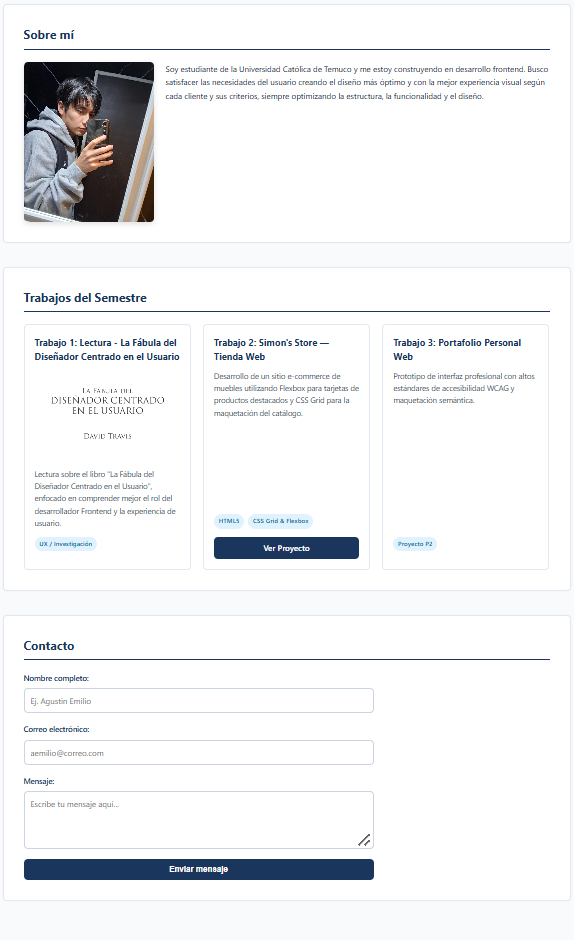

# Portafolio — Simón Millanguir

Proyecto individual de la Evaluación 4 de Desarrollo de Frontend (ICINF1107), Universidad Católica de Temuco. Migración del portafolio de la E2 a una SPA con React, TypeScript y Vite.

## Diseño y funcionalidades

Se conservan los textos, imágenes, colores y tipografía de la E2. Las secciones se organizan en rutas; se añaden repositorios de GitHub, página 404 y tema claro/oscuro.

| Ruta | Vista |
|---|---|
| / | Sobre mí |
| /trabajos | Trabajos y repositorios |
| /contacto | Formulario |
| Cualquier otra | Página 404 |

El formulario valida los campos y prepara un borrador en Gmail; el envío se realiza desde Gmail.

## Ejecución

Se utilizó Node.js 24 y npm. Las versiones de dependencias están en package-lock.json.

~~~bash
git clone https://github.com/smillanguir2026-cloud/evaluacion_4-simon_millanguir.git
cd evaluacion_4-simon_millanguir
npm install
npm run dev
~~~

Abrir la dirección indicada en la terminal.

~~~bash
npm run build
npm run preview
npm run lint
~~~

build verifica TypeScript y genera dist/. preview permite revisar esa compilación localmente. lint ejecuta ESLint.

Para publicar, el alojamiento debe devolver index.html en las rutas SPA. Un despliegue en una subruta requiere ajustar la base de Vite, el router y las rutas de recursos.

## Organización

- components y pages: interfaz y vistas con CSS BEM.
- data y types: datos estáticos, interfaces y props.
- hooks: consultas y acceso al contexto.
- context: proveedor del tema.
- assets/images: imágenes importadas.
- public/simons-store: proyecto HTML original de la tienda.

El formulario usa useState. ThemeProvider comparte el tema con Context API para evitar duplicarlo entre vistas. Se mantiene al navegar y vuelve al modo claro al recargar.

## API de GitHub

Se eligió para mostrar proyectos reales y enlazar su código. No requiere API key para las consultas públicas utilizadas.

Base: https://api.github.com

~~~text
GET /users/smillanguir2026-cloud/repos?sort=updated&per_page=6
GET /repos/smillanguir2026-cloud/Calculadora-Limites
~~~

sort=updated ordena por actualización; per_page=6 limita el listado. El primer endpoint devuelve un arreglo y el segundo un objeto. Ejemplo ilustrativo de sus campos:

~~~json
{
  "id": 123,
  "name": "proyecto",
  "description": null,
  "html_url": "https://github.com/usuario/proyecto",
  "language": "TypeScript",
  "stargazers_count": 0
}
~~~

description y language pueden ser null. La calculadora aparece primero y se excluye mini-portafolio-prueba.

useFetchApi gestiona carga, datos y error; comprueba errores HTTP y cancela peticiones con AbortController. Su caché reutiliza respuestas exitosas en memoria hasta recargar; no deduplica peticiones en curso.

## Verificación y accesibilidad

El 18 de noviembre de 2026, npm run build y npm run lint finalizaron sin errores.

Se implementaron HTML semántico, idioma español, etiquetas asociadas, textos alternativos, foco visible, mensajes accesibles y diseño adaptable. Falta registrar los resultados manuales:

- [ ] Navegación y 404.
- [ ] Uso completo por teclado y foco visible.
- [ ] Ancho de 320 px sin desbordamiento.
- [ ] Contraste y legibilidad en ambos temas.
- [ ] Imágenes y enlace a la tienda.
- [ ] Formulario: campos vacíos, correo inválido y borrador.
- [ ] API: carga, éxito y error.

Para probar errores de conexión, desactivar la red y recargar para evitar la caché; restaurar la conexión al terminar. Marcar solo pruebas realizadas. No se adjunta una auditoría Lighthouse.

## Documentación y Git

- [Inventario de migración](INVENTARIO.md).
- [Declaración de uso de IA](uso_ia.md).

El desarrollo utiliza commits convencionales y Pull Requests desde feat/base-react hacia main. Antes de entregar, confirmar que main contiene los últimos cambios.
